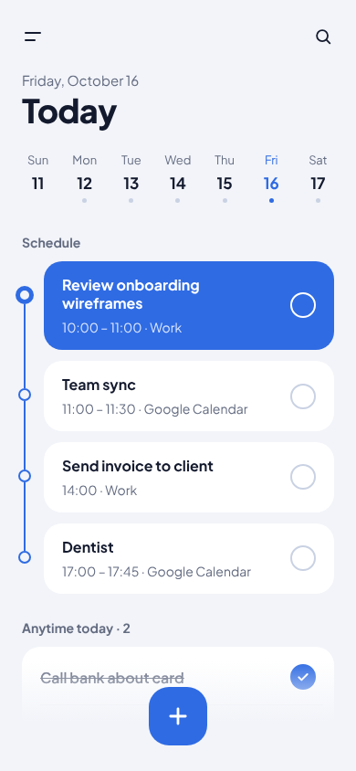
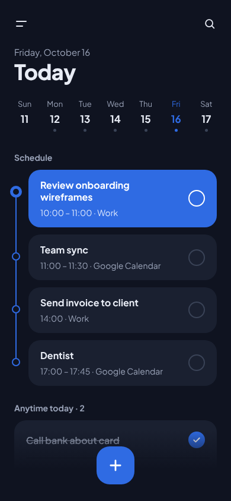

# Design system

Approved 16 Oct 2026: **Style A · Clear blue.** Blue, calm and roomy. All values are in `design/tokens.json`; this page explains how to use them.

 

## Principles (from the owner's review)

1. **No drop shadows** and **no dashed outlines**, anywhere. Separation comes from plain white cards on a grey-blue ground.
2. **Every task and event has a round check** on the right.
3. **Time goes under the title** ("10:00 – 11:00 · Work"), never in a card's corner.
4. **Easy on the eye:** generous padding, 24 px side margins, nothing cramped.
5. **Priority is a ring colour**, not a flag.

## Colour

| Role | Light | Dark |
|---|---|---|
| Ground (screen background) | #F2F4F9 | #0F1320 |
| Card | #FFFFFF | #1A2030 |
| Text | #141A2E | #E8ECF5 |
| Secondary text | #636B80 | #9AA3B8 |
| Lines, empty checks | #C9D2E3 | #3A4357 |
| Tint (selected rows, chips) | #DCE6FB | #1E2D52 |
| Accent fill (buttons, current item) | #2F6BE3 | #2F6BE3 |
| Accent text / links | #2F6BE3 | #7AA2FF |
| Danger | #C7372F | text #FF7D72, ring #E5544A |
| Snackbar | #141A2E | #2C3550 |
| Sheet backdrop | #8E95A6 | #05070D |

Lists: Work #2F6BE3, Personal #E0913A, Learning #3A9E7A; extra list colours purple #7A4FD6, pink #D2467E, slate #5B6478. Shown as a small rounded square (12–14 px, 4 px radius).

Priority ring: high #C7372F, medium #D4A017 (amber, changed 17 Oct; the word "Medium" uses #8A6700 on light, #E3B83A on dark), low #2F6BE3, none = the empty-check grey.

Calendar: tasks are light blue blocks, Google events light grey, the current task solid blue, the "now" line red with a pulsing dot.

## Type

Plus Jakarta Sans (400–800). Screen titles 36 px extra bold; card titles 16 px bold; secondary lines 14 px; group labels 14 px bold grey; buttons 16 px extra bold. See `font.scale` in the tokens.

## Shapes and sizes

- Cards 20 px corners; sheets 28 px top corners; dialogs 26 px; primary buttons 56 px tall with 18 px corners.
- Check circle 28 px with a 2 px border inside a 44 px tap area. Done = filled accent with a white tick, title crossed out and greyed.
- The **+ button**: 64 px rounded square (22 px corners), accent, bottom centre, over a soft fade of the ground colour.
- Phone frame 390 × 844.

## Components (as drawn)

| Component | Where to look |
|---|---|
| Screen header (menu, date line, big title, optional search) | `VToday`, `VInbox`, `VProject` |
| Week strip | `VToday` |
| Timeline (thin accent line, rings, current item filled) | `VToday` |
| Task row and card group | `VProject`, `NNext7` |
| Bottom sheet (grab handle, title, options group, primary button) | `NDatePicker`, `NPriority`, `NRepeat` |
| Radio option list | `NPriority`, `NMoveList` |
| Chips (quick choices) | `NSortNote`, `VQuickAdd` |
| Segmented control | `VCalendar` (Month / Week / Day) |
| Settings rows with values and toggles | `NSettings2` |
| Snackbar with Undo | `NDoneUndo`, `NDeleteUndo` |
| Dialog | `NListDelete`, `NEmptyTrash` |
| Inline offer card | `NSetupGoogle`, `NSetupSort` |
| Lock-screen notification with actions | `VCheckInNotification` |
| Side menu drawer | `NSideMenu2` |

## Motion

- Sheets slide up from the bottom while the backdrop dims.
- The side menu slides in from the left.
- Notifications drop in from the top.
- Snackbars rise in just after the screen.
- Dialogs pop with a slight scale.
- Content eases up: title first, then cards.
- Ticks and success marks pop.
- The sorting progress bar fills.
- The + button pops in.
- Pressed buttons shrink to 96 % (rows to 98.5 %).
- Everything is off when the phone asks for reduced motion.

Timings and easing are in `motion` in the tokens, and the exact CSS is in the `@keyframes lp…` blocks of each `.dc.html` source.

## Dark mode

Every screen has a dark twin (`D` prefix). Settings › Theme: Light, Dark, or follow the phone (default: follow the phone). Google and Android system screens follow their own dark themes.
