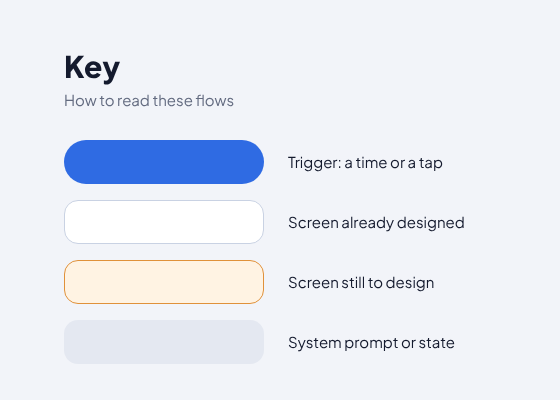
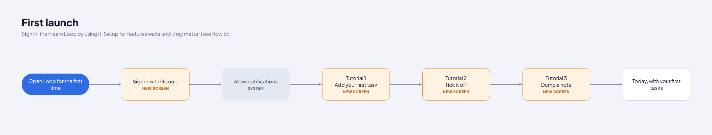
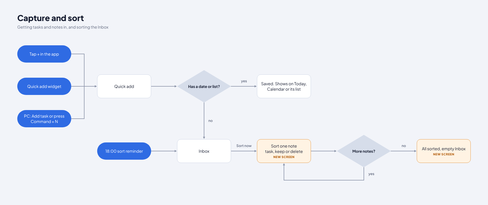
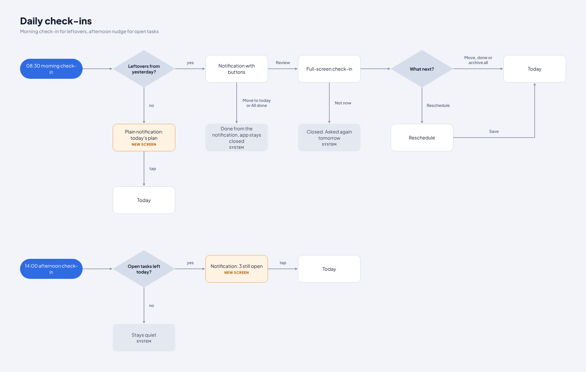
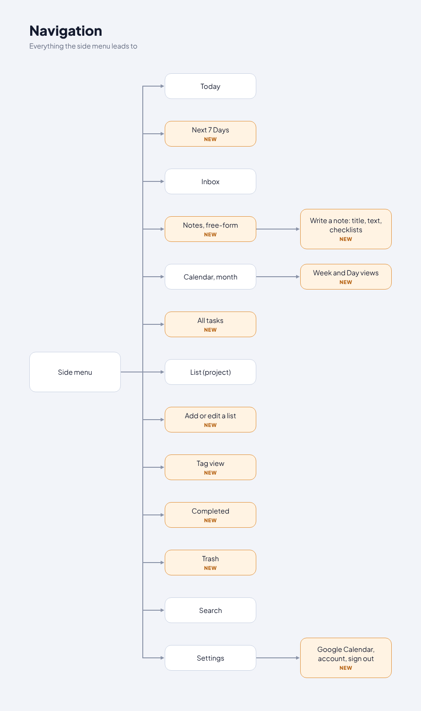
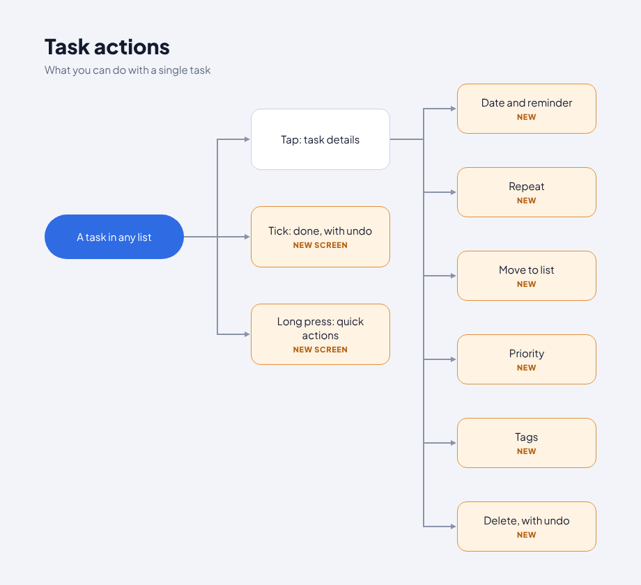
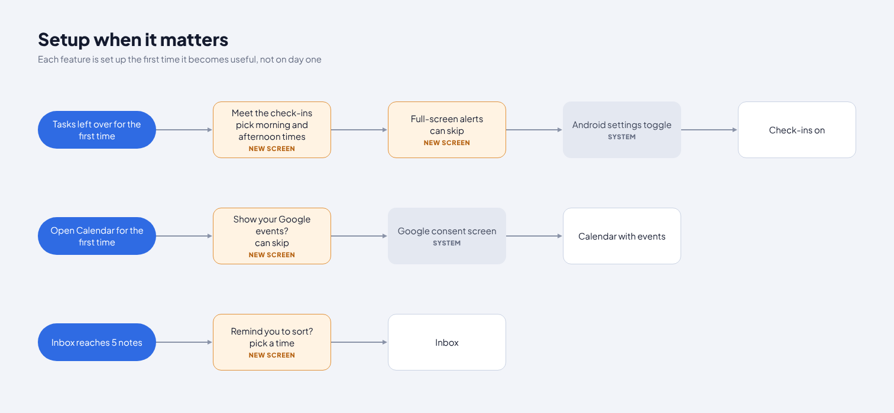

# User flows

Diagrams are in `design/screenshots/flows/` (key: blue pill = trigger, white = screen, orange = screen that was new when the flows were drawn and is now designed, grey = system prompt or state). Screen names below match `docs/04-screens-and-interactions.md`.

## 1. First launch

Open Loop → Sign in with Google `NSignIn` → Allow notifications `NAllowNotif` (Android prompt) → Tutorial 1 add a task `NTut1` → Tutorial 2 tick it off `NTut2` → Tutorial 3 dump a note `NTut3` → Today with your first task `NTutDone`. Skip on any tutorial step jumps to the end.

## 2. Capture and sort

+ in the app, the quick add widget, or a keyboard shortcut on the computer → Quick add `VQuickAdd`.
- Has a date or list? **Yes** → saved to Today, Calendar or its list (`NAdded`). **No** → Inbox (`NQuickAddInbox` → `NAddedInbox`).
- 18:00 sort reminder `NSortNotif` (or Sort now in `VInbox`) → Sort one note `NSortNote` / `NSortNoteSet` / `NMovedToNotes` → more notes? loop → All sorted `NAllSorted` → optional Undo sorting `NUndoSorting`.

## 3. Daily check-ins

- 08:30 → leftovers from yesterday?
  - **Yes** → notification with buttons `VCheckInNotification`.
    - Move to today / All done → done from the notification, app stays closed (`NNotifActed`).
    - Not now (swipe away) → closed, asked again tomorrow.
    - Review → full-screen check-in `VCheckIn` → move, done or archive all → Today `NAfterCheckin`; or Reschedule `VCheckInReschedule` → Save → Today.
  - **No** → plain "today's plan" notification `NMorningPlain` → tap → Today.
- 14:00 → open tasks left today? **Yes** → notification "3 still open" `NAfternoon` → tap → Today. **No** → stays quiet.

## 4. Navigation

Side menu `NSideMenu2` → Today, Next 7 Days `NNext7`, Inbox, Notes `NNotes` → note editor `NNoteEditor`, Calendar month → week `NCalWeek` and day `NCalDay`, All tasks `NAllTasks`, List `VProject`, Add or edit a list `NListNew` / `NListMenu`, Tag view `NTagView`, Completed `NCompleted`, Trash `NTrash`, Search `VSearch`, Settings `NSettings2` → Google Calendar, account, sign out `NAccount`.

## 5. Task actions

A task in any list → Tap: task details `VTaskDetail` · Tick: done with undo `NDoneUndo` · Long press: quick actions `NQuickActions` → Date and reminder `NDatePicker`, Repeat `NRepeat`, Move to list `NMoveList`, Priority `NPriority`, Tags `NTags`, Delete with undo `NDeleteUndo`.

## 6. Setup when it matters

- Tasks left over for the first time → Meet the check-ins `NSetupCheckins` → Full-screen alerts `NSetupFullScreen` → Android settings toggle `NAndroidFullScreen` → Check-ins on `NCheckinsOn`.
- Open Calendar for the first time → Show your Google events? `NSetupGoogle` → Google consent `NGoogleConsent` → Calendar with events `NCalendarConnected`.
- Inbox reaches 5 notes → Remind you to sort? `NSetupSort` → Inbox `NSortReminderOn`.
